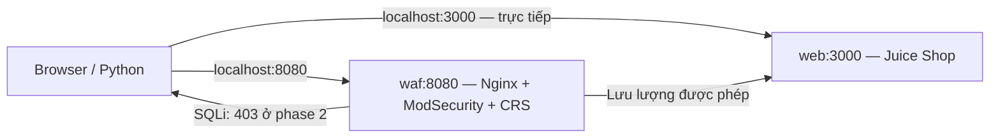
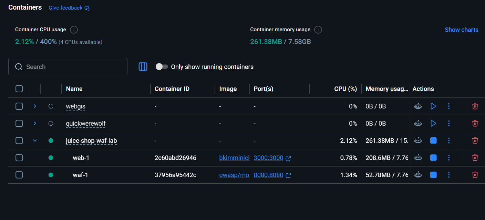
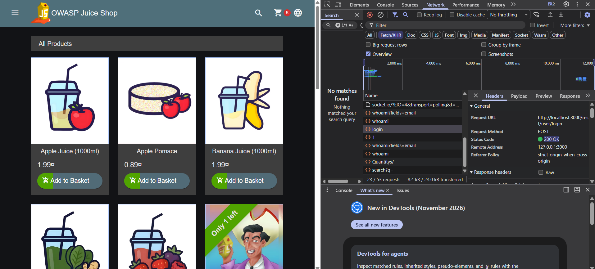
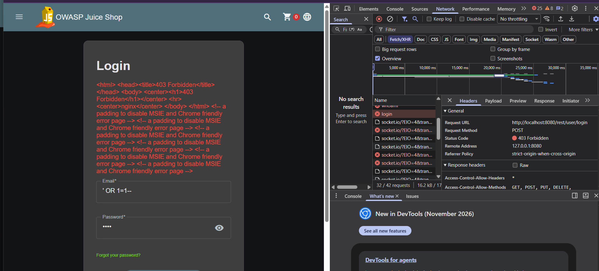
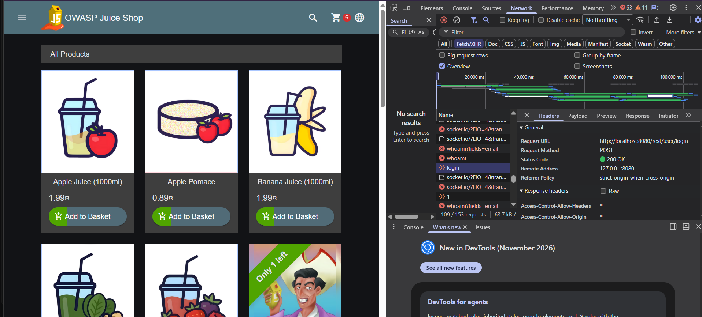

## 1. Mục tiêu và mô hình

Chứng minh cùng một SQL Injection có thể bypass đăng nhập khi truy cập Juice Shop trực tiếp, nhưng bị OWASP CRS phát hiện và ModSecurity chặn khi đi qua reverse proxy Nginx. Kiểm tra thêm đăng nhập hợp lệ để xác nhận WAF vẫn chuyển tiếp lưu lượng bình thường.



## 2. Môi trường thực tế

| Thành phần | Phiên bản đã quan sát |
|---|---|
| Host | Windows, PowerShell trong workspace `D:\VSCode\Python\JuiceShop` |
| Docker Desktop | 4.91.0, Linux engine 29.8.0 |
| Docker Compose | v5.5.1, dùng lệnh `docker compose` và cú pháp tương thích V2 |
| Python | 3.13.1, chỉ standard library |
| Juice Shop | 20.3.0, image `bkimminich/juice-shop:latest`, revision `e39a3bd` |
| Nginx | 1.30.6, theo metadata image WAF |
| ModSecurity | 3.0.17; Nginx connector 1.0.4, theo startup/audit log |
| OWASP CRS | 4.30.0, theo audit log |
| Trạng thái container | Cả `web` và `waf` đã được quan sát `healthy` |

Digest của image đã chạy, dùng để tái lập khi rolling tags thay đổi:

```text
bkimminich/juice-shop@sha256:42843723a7bf4246aa5d63c324978b17ef296ac78434aeddd34c427bfb5853f4
owasp/modsecurity-crs@sha256:7698c48a41a43138ae317feeec964d1515b861cc1d9e50617bc1cdfe9f314e1d
```

Không bổ sung custom blocking rule hoặc thay đổi tài khoản để tạo kết quả mong đợi. WAF dùng `MODSEC_RULE_ENGINE=On`, JSON request body inspection, paranoia level 1 và inbound threshold 5.

## 3. Phương pháp và kết quả thực tế

Các lệnh đã chạy:

```powershell
docker compose config --quiet
docker compose up -d
docker compose ps
docker compose exec -T waf nginx -t
python -X utf8 test_lab.py --output evidence/results.json
docker compose logs --no-color --no-log-prefix waf
```

Compose hợp lệ; `nginx -t` thành công; hai container chạy thật. Bộ kiểm thử cuối cùng trả exit code **0**, **9/9 kiểm tra đạt**.

Body SQLi gửi giống nhau tới `POST /rest/user/login` trên cả hai cổng:

```json
{"email": "' OR 1=1--", "password": "test"}
```

| Kịch bản | Không qua WAF (:3000) | Qua WAF (:8080) | Đánh giá |
|---|---|---|---|
| GET giao diện | HTTP 200, HTML Juice Shop | HTTP 200, HTML Juice Shop | Đạt |
| SQL Injection | HTTP 200, `admin@juice-sh.op`, role `admin`, có token | HTTP 403, CRS chặn phase 2 | Test 1 và 2 đạt |
| Login `admin@juice-sh.op` / `admin123` | HTTP 200, admin | HTTP 200, admin | Test 3 đạt; credentials hợp lệ với bản này |
| Mật khẩu sai thông thường | HTTP 401 | HTTP 401 | Backend từ chối xác thực, WAF không chặn nhầm |
| Rule log của SQLi | Không đi qua WAF | `942100`, `949110`, engine Enabled, interrupted=true | Test 4 đạt |

Nguồn số liệu: [evidence/results.json](evidence/results.json). Run ID: `b9e1556217234310891a12bc615adba4`.

Việc GET HTML và kiểm thử API đã được thực thi. **Chưa thực hiện thao tác form trên trình duyệt hoặc chụp ảnh màn hình**; phần dưới dành cho sinh viên bổ sung khi demo.

## 4. Bằng chứng và giải thích chặn

Audit event của request có header `X-Lab-Test: b9e1556217234310891a12bc615adba4-waf`, transaction ID **`179314723131.087971`**:

```text
942100: SQL Injection Attack Detected via libinjection
Matched Data: s&1c found within ARGS:json.email: ' OR 1=1--
949110: Inbound Anomaly Score Exceeded (Total Score: 5)
secrules_engine: Enabled
http_code: 403
is_interrupted: true
```

Error log của cùng transaction ID:

```text
ModSecurity: Access denied with code 403 (phase 2).
[id "949110"] [msg "Inbound Anomaly Score Exceeded (Total Score: 5)"]
[ver "OWASP_CRS/4.30.0"] [unique_id "179314723131.087971"]
```

Đây là trích các trường từ log thật. Rule `942100` phân tích giá trị email bằng libinjection và cộng 5 điểm. Rule `949110` quyết định deny khi score đạt threshold 5. Deny xảy ra ở **request-body phase 2**, trước khi Nginx proxy request đến backend; không phải backend từ chối credentials hay WAF chỉ ghi log. Không có custom rule trả 403 cho riêng payload.

Trong Juice Shop, email được ghép vào SQL; `'` thoát chuỗi, `OR 1=1` làm điều kiện đúng, `--` vô hiệu phần điều kiện mật khẩu phía sau. Ở image đã chạy, truy vấn trả về tài khoản admin. Qua WAF, JSON body parser đưa dữ liệu vào `ARGS:json.email` để CRS kiểm tra.

## 5. Ảnh chụp

1. **Ảnh 1 — Kiến trúc đang chạy:** `docker compose ps`, hai container healthy, port chỉ bind `127.0.0.1`.

   

2. **Ảnh 2 — Test 1:** URL cổng 3000, login admin sau SQLi, Network của POST login có status 200.

   

3. **Ảnh 3 — Test 2:** URL cổng 8080, cùng payload, Network hiển thị POST login status 403.

   

4. **Ảnh 4 — Test 3:** đăng nhập admin hợp lệ qua cổng 8080, status 200.

   


## 6. Kết luận và giới hạn

Trong các trường hợp đã chạy, WAF chặn SQLi và vẫn cho đăng nhập hợp lệ qua proxy. Dấu hiệu phát hiện và quyết định chặn được xác minh bằng CRS rule IDs cùng log phase 2. Kết quả này không khẳng định WAF chặn mọi kiểu tấn công.

WAF không sửa SQL Injection tại backend; biện pháp gốc là parameterized queries. False positives có thể xuất hiện với dữ liệu hợp lệ trông giống cú pháp tấn công; cần phân tích rule và field để tuning hẹp. Cổng 3000 được mở có chủ đích để so sánh trong lab; trong kiến trúc bảo vệ thực tế không cho client bypass WAF.

Hướng dẫn tái lập và demo: [README.md](README.md). Nguồn chính thức: [image CRS](https://github.com/coreruleset/modsecurity-crs-docker), [login Juice Shop](https://github.com/juice-shop/juice-shop/blob/master/routes/login.ts), [CRS SQLi rules](https://github.com/coreruleset/coreruleset/blob/v4.30.0/rules/REQUEST-942-APPLICATION-ATTACK-SQLI.conf).
